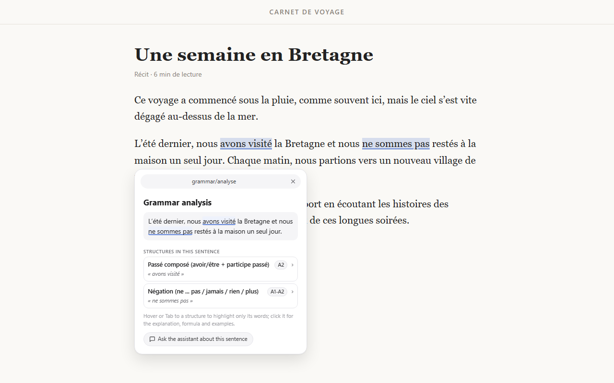

# TextChecker – French grammar in context

A browser extension (Chrome, Edge, Firefox) for learning French from the pages you read.
Select a word to look it up, keep a vocabulary notebook, see which grammar structures a
sentence uses, read a short grammar card and write your own sentence to get feedback.



## Features

- **Word lookup** (Alt+Shift+D): definition, examples, etymology and English translation from Wiktionary, pronunciation, links to Larousse, Le Robert, CNRTL and Google Translate.
- **Vocabulary notebook**: ☆ saves a word with the sentence and page where you met it. Flashcard review, saved words highlighted on pages, CSV/JSON export and import.
- **Grammar analysis** (Alt+Shift+G or "Analyze grammar" on a selected sentence): structures used in the sentence with their CEFR level, highlighted in the page.
- **Grammar cards**: formula, explanation, conjugation, key points, examples (the sentence you are reading first), "Read more" links.
- **Practice**: write a sentence with the structure; see whether it is used, the errors underlined, a correction. History in the popup.
- **Writing check**: mistakes in text fields are underlined, fixed in one click (local rules; AI providers optional).
- **Assistant side panel** (Alt+Shift+K), bookmarks, keyboard navigation everywhere, light and dark themes, interface in Vietnamese, English and French.

Grammar analysis, grammar cards and practice need the project's grammar backend (`../backend`, FastAPI + spaCy)
running locally; the address is set in Settings (default `http://127.0.0.1:8000`):

```bash
cd backend
pip install -r requirements.txt
python -m spacy download fr_core_news_md
uvicorn app.main:app --port 8000
```

## Install

- **From a release**: download `textchecker-<version>-chrome.zip` from the Releases page, extract it, open `chrome://extensions/` (or `edge://extensions/`), turn on Developer mode, "Load unpacked" and choose the folder. Firefox: `about:debugging#/runtime/this-firefox` → "Load Temporary Add-on" → choose `textchecker-<version>-firefox.zip`.
- **From source**: `npm install`, `npm run build`, then load `.output/chrome-mv3`.

## Development

```bash
npm run dev            # dev server with hot reload (Chrome)
npm run build          # production build (.output/chrome-mv3)
npm run build:firefox  # Firefox build (.output/firefox-mv2)
npm test               # unit tests (vitest)
npm run e2e            # build, then end-to-end tests in Chrome (see e2e/README.md)
npm run zip            # store package: .output/textchecker-<version>-chrome.zip
npm run zip:firefox    # Firefox package and sources zip
```

## Release

1. Set the version in `package.json` (the manifest takes it from there).
2. Push a tag with the same version (`1.0.1` or `v1.0.1`). The `Release` workflow checks the tag, runs the tests, builds the zips and creates a GitHub release.
3. Upload `textchecker-<version>-chrome.zip` to the Chrome Web Store and Edge Add-ons with the texts and screenshots in [store/listing.md](store/listing.md).

Icons come from `public/icon.svg` (`node scripts/render-icons.mjs`); store screenshots from `node scripts/store-screenshots.mjs` after a build.

## Privacy

No account, no analytics. Words go to Wiktionary when you look them up; sentences go only to the grammar backend you set. Everything else stays in the browser. See [PRIVACY.md](PRIVACY.md).

## Tech stack

[WXT](https://wxt.dev/) (Manifest V3), React 19, Tailwind CSS 4, TypeScript; vitest and puppeteer-core for tests.

## License

MIT, see [LICENSE](LICENSE).
